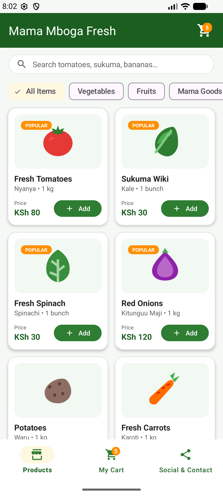
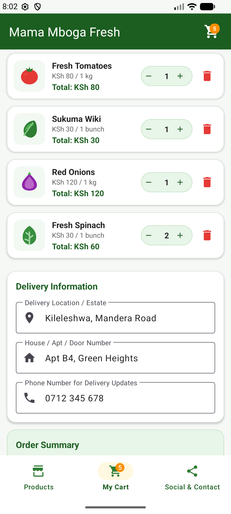
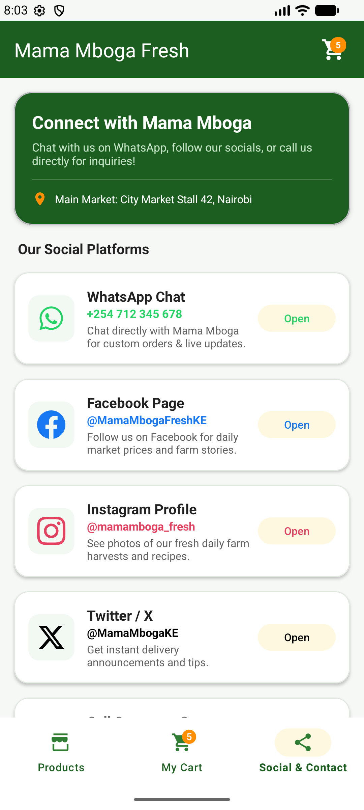
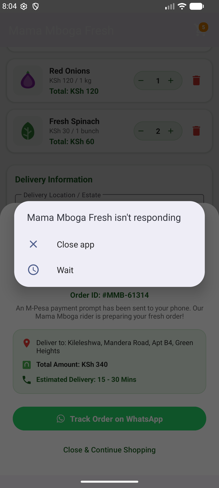

# Mama Mboga Fresh (Soko Mkononi) 🛒🥦🍎

**Mama Mboga Fresh** is a modern, fast, and user-friendly native Android application designed for ordering fresh market produce (vegetables, fruits, and grocery goods) in Kenya with prices listed in **Kenyan Shillings (KSh)**.

---

## 📸 App Screenshots

| 🥦 Fresh Produce Catalog | 🛒 Cart & Delivery Details |
| :---: | :---: |
|  |  |

| 📲 Social Media & Contacts | ✅ Order Confirmation Modal |
| :---: | :---: |
|  |  |

---

## 🌟 Key Features

- ** Fresh Produce Catalog (Priced in KSh)**:
  - **Vegetables**: Fresh Tomatoes (*Nyanya* - KSh 80/kg), Sukuma Wiki (*Kale* - KSh 30/bunch), Spinach (KSh 30/bunch), Red Onions (KSh 120/kg), Potatoes (*Waru* - KSh 150/kg), Carrots (KSh 70/kg), Cabbage (KSh 60/head), Green Capsicum (*Hoho* - KSh 100/kg), and Garlic (KSh 50).
  - **Fruits**: Sweet Bananas (*Ndizi* - KSh 100/bunch), Ripe Mangoes (KSh 120/kg), Hass Avocados (KSh 40/pc), Watermelon (KSh 200/slice), and Oranges (KSh 150/kg).
  - **Mama Goods**: Fresh Eggs (*Mayai* - KSh 300/tray), Refined Cooking Oil (KSh 180/L), Maize Flour (*Sembe / Unga wa Ugali* - KSh 150/2kg), Pishori Rice (KSh 220/kg), and Yellow Beans (KSh 160/kg).
- ** Distinct Produce Icons**:
  - Custom vector drawables for every produce item (tomato, kale, banana, avocado, eggs, oil, flour, etc.).
- ** Real-time Shopping Cart**:
  - Add items to cart with single-tap controls.
  - Adjust quantities (`+` / `-`) or remove items seamlessly.
  - Subtotal in KSh, delivery fee calculation (FREE delivery on orders above KSh 1,000!), and grand total.
  - Dynamic badge counters on the top bar and bottom navigation bar.
- ** Delivery Location & House Details**:
  - Delivery Location / Estate input field (e.g., *Kileleshwa, Mandera Road*).
  - House / Apartment / Door Number field (e.g., *Apt B4, Green Heights*).
  - Customer Phone Number field for M-Pesa & delivery updates.
- ** Social Media Accounts & Direct Contact**:
  - **WhatsApp**: Direct chat with prefilled order inquiry (*+254 712 345 678*).
  - **Facebook**: `@MamaMbogaFreshKE`
  - **Instagram**: `@mamamboga_fresh`
  - **Twitter / X**: `@MamaMbogaKE`
  - **Phone Call**: Direct dialer support (*+254 712 345 678*).
  - Physical market location (*City Market Stall 42, Nairobi*).
- ** M-Pesa Order Placement**:
  - Interactive Bottom Sheet confirmation dialog displaying Order ID, delivery address, total amount paid, and direct **Track Order on WhatsApp** button.

---

## 🛠️ Tech Stack & Architecture

- **Language**: Kotlin
- **UI Architecture**: ViewBinding, Material Design 3, CoordinatorLayout, NestedScrollView, RecyclerView, MaterialCardView, BottomNavigationView, BottomSheetDialog
- **Design System**: Custom Fresh Green & Amber palette with native XML Vector Drawables
- **Min SDK**: 24 (Android 7.0+)
- **Target SDK**: 37 (Android 15+)

---

## 🚀 How to Run the App

1. Clone or download this repository:
   ```bash
   git clone https://github.com/abdullahidahir334-cyber/mamamboga.git
   ```
2. Open the project in **Android Studio**.
3. Let Gradle sync dependencies automatically.
4. Run the app on an Android Emulator or connected physical device.

---

## 📱 Developer & Contact

Developed for **Mama Mboga Fresh • Soko Mkononi**.  
For inquiries or feedback, reach out via WhatsApp (+254 712 345 678) or follow our social media accounts!
